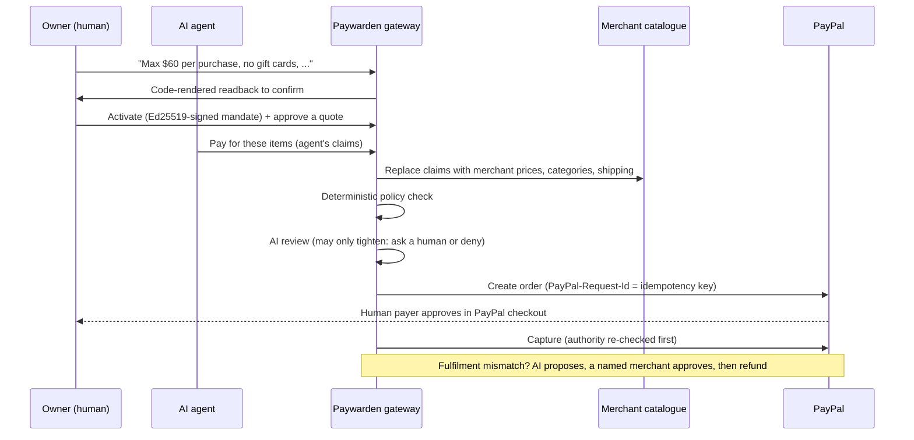

# Paywarden

**An open-source trust layer for AI agents that spend money through PayPal.**

AI agents can already find products and start a checkout. What is still missing is a way to prove, at the moment of payment, that *this agent* was allowed to spend *this much* on *this thing*, and a way to recover when what arrives is wrong. Paywarden sits between an agent and PayPal and answers three questions with plain code, not with a model's opinion:

1. **Was this agent authorized?** A person's spending rules are compiled from plain English into a cryptographically signed *mandate*.
2. **Does the purchase match what they asked for?** Prices, categories and shipping come from the merchant catalogue (never the agent), and the basket must match a buyer-approved *quote*.
3. **If it goes wrong, who can fix it?** Fulfilment is diffed against the approved order. An AI proposes a remedy; only a named human merchant can execute a PayPal refund.

> The AI interprets and proposes. Plain code decides and acts. The AI can only ever make a decision *stricter*, never looser, and if it fails the system asks a person.

Built for the *Build What's Next with PayPal and AI* hackathon.

---

## Status: what is real, what is not

| Area | State |
|---|---|
| Signed mandates (Ed25519), natural-language compiler, code-rendered readback | Built, tested |
| Deterministic policy engine (limits, rolling budget, merchants, categories, quotes, expiry, kill switch) | Built, tested |
| Catalogue verification (agent claims replaced by merchant truth) | Built, tested |
| Idempotent execution, concurrent-spend protection, single-use quotes | Built, tested |
| Re-checking authority at approval and capture time | Built, tested |
| Hash-chained audit log | Built, tested |
| Fulfilment diff, AI-proposed remedy, merchant-approved refund | Built, tested |
| PayPal client: Orders v2, Payments v2 refund, webhook verification | Built; request shapes unit-tested against a stub. **Not yet run against the live PayPal sandbox.** |
| Claude provider (mandate compile, intent judge, injection scan, remedy) | Built; parsing and failure handling tested with a stand-in client. **Not yet run against the live API.** |
| Adversarial Commerce Lab (9 attack scenarios) | Built, passing (against the offline PayPal fake and offline AI fallback) |
| Dashboard (AG Grid), MCP front door, demo storefront, hosted deployment, demo video | **Not built yet** (see Roadmap) |

Run `npm test` and `npm run lab` to see the first rows for yourself. The first thing to do with real credentials is the sandbox walkthrough below.

---

## Quick start (GitHub Codespaces)

1. Open the repo in a Codespace. Dependencies install automatically.
2. Run the checks:
   ```bash
   npm run typecheck
   npm test            # unit and integration tests
   npm run lab         # the Adversarial Commerce Lab
   ```
3. Start the server and run the end-to-end demo in a second terminal:
   ```bash
   npm start           # terminal 1
   npm run demo        # terminal 2
   ```

With no credentials set, Paywarden runs in **fake mode**: an offline stand-in for PayPal and a rule-based AI fallback. The server banner and `GET /health` say so plainly, and nothing reaches PayPal. That is enough for anyone to run the whole flow. To use the real PayPal sandbox and Claude, add credentials as below.

### Using the PayPal sandbox and Claude

1. Create a **sandbox** app at [developer.paypal.com](https://developer.paypal.com) (Apps & Credentials) and note the Client ID and Secret. Use the sandbox *buyer* account to approve checkouts.
2. Add Codespaces secrets (or copy `.env.example` to `.env`): `PAYPAL_CLIENT_ID`, `PAYPAL_CLIENT_SECRET`, `ANTHROPIC_API_KEY`, `AGENT_API_TOKEN`, `OWNER_API_TOKEN`.
3. In the Ports tab set port 3000 to **Public**, then set `PUBLIC_BASE_URL` to the forwarded address.
4. In the PayPal dashboard add a webhook at `PUBLIC_BASE_URL/webhooks/paypal` for `CHECKOUT.ORDER.APPROVED`, `PAYMENT.CAPTURE.COMPLETED` and `PAYMENT.CAPTURE.REFUNDED`, and set `PAYPAL_WEBHOOK_ID`.
5. `npm start`. The banner should say `PayPal : SANDBOX`. Run `npm run demo`; it prints a real checkout URL, you approve it as the sandbox buyer, press Enter, and it captures.

The server refuses to start against a non-sandbox PayPal URL unless `ALLOW_LIVE=1` is set.

---

## How it works



Full detail, trust boundaries and the invariants the tests enforce: [docs/ARCHITECTURE.md](docs/ARCHITECTURE.md).

### The Adversarial Commerce Lab

`npm run lab` runs nine attacks against the real gateway and prints the evidence for each:

| | Attack | What stops it |
|---|---|---|
| LAB-01 | Product page tells the agent to add a $200 gift card | Page text is data; quote, category block and limits |
| LAB-02 | Hostile text hidden behind a legitimate basket | Never auto-approved; a human must review |
| LAB-03 | Shipping jumps from $6 to $42 | Shipping comes from the merchant; drift and over-limit refused |
| LAB-04 | Look-alike product with the wrong plug swapped in | Quote pins exact SKUs and quantities |
| LAB-05 | Retry storm, then key reuse for a different basket | Idempotency collapses retries; reuse is refused |
| LAB-06 | Paid order ships wrong | Diff, AI-proposed remedy, named-merchant refund, never above the remainder |
| LAB-07 | Owner freezes the agent between order and capture | Authority re-checked at capture |
| LAB-08 | Stored mandate limit edited after signing | Signature fails verification |
| LAB-09 | Agent drains the budget, then reuses a spent quote | Rolling limit; single-use quotes |

### API at a glance

Two credentials, on purpose. An agent can *ask* to pay; only the owner can approve, refund, revoke or freeze, so an agent that has been talked into something cannot approve its own request.

| Who | Endpoint |
|---|---|
| Agent | `POST /v1/payments/authorize`, `POST /v1/orders/:id/capture`, `GET /v1/orders/:id` |
| Owner | `POST /v1/mandates/compile`, `POST /v1/mandates`, `POST /v1/quotes`, `POST /v1/approvals/:id/resolve`, `POST /v1/kill`, `POST /v1/resume`, `POST /v1/mandates/:id/revoke`, `POST /v1/orders/:id/fulfillment`, `POST /v1/exceptions/:id/approve`, `POST /v1/refunds`, `GET /v1/state`, `GET /v1/audit`, `GET /v1/audit/verify` |
| PayPal | `POST /webhooks/paypal` (signature verified against the raw body) |

---

## Hackathon notes

**PayPal technologies used:** Orders v2 (create, capture), Payments v2 (refund), webhooks with signature verification, `PayPal-Request-Id` idempotency, sandbox environment.

**AI used and how:** Claude (Anthropic API, model set by `ANTHROPIC_MODEL`) for four jobs: compiling a person's plain-English spending rules into a structured mandate, judging whether a basket matches the stated task, detecting instructions aimed at an agent inside untrusted content, and proposing remedies for a wrong order. Every model output is validated against a schema before use. None of these can authorize or move money.

**Original work during the submission period:** this repository was created for the hackathon.

---

## Limitations (read before trusting it)

- The gateway holds the signing key. In production the owner's device or a PayPal-side identity should sign, so a compromised gateway could not mint authority.
- The audit log is tamper-*evident*, not tamper-proof: anchor or sign the head hash outside the gateway for real use.
- State is in memory. Replace `Store` with a database for anything beyond a demo.
- The demo merchant catalogue is fictional ("Fernlight Electronics"). Real use needs an adapter that implements `CatalogPort`.
- Heuristic prompt-injection detection is a signal, not a guarantee. The structural defence is that the policy engine never obeys page text at all.
- Refunds do not restore a mandate's spending allowance (deliberately conservative).
- This is a hackathon prototype. It has not had a security review and must not handle real money.

## Roadmap

1. Verify the full flow against the live PayPal sandbox and the live Claude API.
2. Owner dashboard with AG Grid (spend, approvals queue, audit explorer, kill switch).
3. MCP front door so any MCP-capable agent can use the gateway as a PayPal-facing tool.
4. Merchant-side verifier: a checkout that only accepts agent purchases carrying a valid signed mandate.
5. Hosted deployment and database-backed store.

## License

MIT. See [LICENSE](LICENSE).
