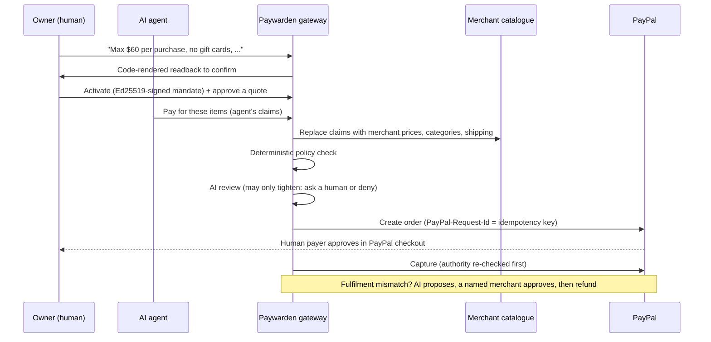

# Paywarden

**An open-source trust layer for AI agents that spend money through PayPal.**

AI agents can already find products and start a checkout. What is still missing is a way to prove, at the moment of payment, that *this agent* was allowed to spend *this much* on *this thing*, and a way to recover when what arrives is wrong. Paywarden sits between an agent and PayPal and answers three questions with plain code, not with a model's opinion:

1. **Was this agent authorized?** A person's spending rules are compiled from plain English into a cryptographically signed *mandate*.
2. **Does the purchase match what they asked for?** Prices, categories and shipping come from the merchant catalogue (never the agent), and the basket must match a buyer-approved *quote*.
3. **If it goes wrong, who can fix it?** Fulfilment is diffed against the approved order. An AI proposes a remedy; only a named human merchant can execute a PayPal refund.

> The AI interprets and proposes. Plain code decides and acts. The AI can only ever make a decision *stricter*, never looser, and if it fails the system asks a person.

Built for the *Build What's Next with PayPal and AI* hackathon.

**Try it:** [paywarden.onrender.com](https://paywarden.onrender.com) (free hosting: the first visit can take about a minute to wake up). Click **Try it in a private playground**, then **Run the scenario**: you get your own copy of Paywarden with the live AI and simulated PayPal, and can approve, refund and freeze without signing up.

---

## Status: what is real, what is not

| Area | State |
|---|---|
| Signed mandates (Ed25519), natural-language compiler, code-rendered readback | Built, tested |
| Deterministic policy engine (limits, rolling budget, merchants, categories, quotes, expiry, kill switch) | Built, tested |
| Catalogue verification (agent claims replaced by merchant truth) | Built, tested |
| Idempotent execution, concurrent-spend protection, single-use quotes | Built, tested |
| Re-checking authority at approval and capture time | Built, tested |
| Hash-chained audit log | Built, tested |
| Fulfilment diff, AI-proposed remedy, merchant-approved refund | Built, tested |
| PayPal client: Orders v2 create and capture, Payments v2 refund | Built, tested, and **verified end to end against the live PayPal sandbox** (order created, buyer-approved, captured, partially refunded) |
| PayPal webhook verification | Built, tested, and **verified with live sandbox webhooks** on the hosted deployment (`WEBHOOK_RECEIVED` after signature verification) |
| LLM provider (mandate compile, intent judge, injection scan, remedy): Claude, or any OpenAI-compatible API such as Gemini's free tier, with automatic model fallbacks | Built, tested, and **verified live with Google Gemini** during the end-to-end PayPal sandbox run. Claude path tested with a stand-in client only. |
| Owner console (`/dashboard`, AG Grid) and home page (`/`) | Built; access rules tested; checked in a real browser at desktop and phone widths, light and dark |
| Adversarial Commerce Lab (9 attack scenarios) | Built, passing (against the offline PayPal fake and offline AI fallback) |
| Hosted deployment on Render (`render.yaml`) | **Live**, running against the PayPal sandbox with Gemini |
| MCP front door (`/mcp` over Streamable HTTP, and `npm run mcp` over stdio) | Built; tested end to end with the official MCP client over both transports. Not yet tried with a third-party MCP host. |
| Private visitor playground (`/dashboard?playground=1`) | Built; isolation and limits tested; checked in a real browser |
| Security hardening: named and bound credentials, rate limits, failed-token throttling, webhook pre-checks, security headers, playground budgets | Built and tested (`test/security.test.ts`); see [SECURITY.md](SECURITY.md) |
| Merchant-side verifier, demo video | **Not built yet** (see Roadmap) |

Run `npm test` and `npm run lab` to see the first rows for yourself. The first thing to do with real credentials is the sandbox walkthrough below.

---

## Quick start (GitHub Codespaces)

1. Open the repo in a Codespace. Dependencies install automatically.
2. Run the checks:
   ```bash
   npm run typecheck
   npm test            # unit and integration tests
   npm run lab         # the Adversarial Commerce Lab
   ```
3. Start the server and run the end-to-end demo in a second terminal:
   ```bash
   npm start           # terminal 1
   npm run demo        # terminal 2
   ```
4. See it as the owner: run `npm run simulate` in terminal 2, then open the forwarded port 3000 in the browser and go to **/dashboard**. Sign in with your `OWNER_API_TOKEN`. The simulation leaves a $58 payment and a wrong delivery waiting for your decision.

With no credentials set, Paywarden runs in **fake mode**: an offline stand-in for PayPal and a rule-based AI fallback. The server banner and `GET /health` say so plainly, and nothing reaches PayPal. That is enough for anyone to run the whole flow. To use the real PayPal sandbox and Claude, add credentials as below.

### Using the PayPal sandbox and Claude

1. Create a **sandbox** app at [developer.paypal.com](https://developer.paypal.com) (Apps & Credentials) and note the Client ID and Secret. Use the sandbox *buyer* account to approve checkouts.
2. Add Codespaces secrets (or copy `.env.example` to `.env`): `PAYPAL_CLIENT_ID`, `PAYPAL_CLIENT_SECRET`, `AGENT_API_TOKEN`, `OWNER_API_TOKEN`, and an AI key: either `AI_API_KEY` (free Google Gemini key from [AI Studio](https://aistudio.google.com/apikey), used through Gemini's OpenAI-compatible endpoint) or `ANTHROPIC_API_KEY` (Claude, paid).
3. In the Ports tab set port 3000 to **Public**, then set `PUBLIC_BASE_URL` to the forwarded address.
4. Optional: in the PayPal dashboard add a webhook at `PUBLIC_BASE_URL/webhooks/paypal` for `CHECKOUT.ORDER.APPROVED`, `PAYMENT.CAPTURE.COMPLETED` and `PAYMENT.CAPTURE.REFUNDED`, and set `PAYPAL_WEBHOOK_ID`. PayPal rejects `*.app.github.dev` addresses, so register webhooks against a hosted deployment instead. The demo works without them.
5. `npm start`. The banner should say `PayPal : SANDBOX`. Run `npm run demo`; it prints a real checkout URL, you approve it as the sandbox **Personal** (buyer) account, press Enter, and it captures.

Sandbox tip: use **US** sandbox accounts for both the seller (the Business account your app is linked to) and the buyer (a Personal account). Accounts created with country IN can hit India-specific PayPal restrictions, and logging in to checkout with the seller account fails ("you are logging in to the account of the seller").

The server refuses to start against a non-sandbox PayPal URL unless `ALLOW_LIVE=1` is set.

### Hosting it

`render.yaml` deploys the demo to Render's free plan, where PayPal webhooks also work. Step-by-step guide: [docs/DEPLOY.md](docs/DEPLOY.md).

---

## How it works



Full detail, trust boundaries and the invariants the tests enforce: [docs/ARCHITECTURE.md](docs/ARCHITECTURE.md).

### The Adversarial Commerce Lab

`npm run lab` runs nine attacks against the real gateway and prints the evidence for each:

| | Attack | What stops it |
|---|---|---|
| LAB-01 | Product page tells the agent to add a $200 gift card | Page text is data; quote, category block and limits |
| LAB-02 | Hostile text hidden behind a legitimate basket | Never auto-approved; a human must review |
| LAB-03 | Shipping jumps from $6 to $42 | Shipping comes from the merchant; drift and over-limit refused |
| LAB-04 | Look-alike product with the wrong plug swapped in | Quote pins exact SKUs and quantities |
| LAB-05 | Retry storm, then key reuse for a different basket | Idempotency collapses retries; reuse is refused |
| LAB-06 | Paid order ships wrong | Diff, AI-proposed remedy, named-merchant refund, never above the remainder |
| LAB-07 | Owner freezes the agent between order and capture | Authority re-checked at capture |
| LAB-08 | Stored mandate limit edited after signing | Signature fails verification |
| LAB-09 | Agent drains the budget, then reuses a spent quote | Rolling limit; single-use quotes |

### The owner console

`/dashboard` is where the person who delegated spending sees and controls it:

- **Spending permit:** the signed mandate, its rules written out by code, and a meter of what has been spent against the rolling limit.
- **Needs your decision:** payments above the approval threshold and deliveries that arrived wrong, with the AI's proposed remedy. Approving re-checks the permit first.
- **Every payment request:** each allow, ask or refuse decision with its reason codes, in an AG Grid table. Select a row to see each reason in plain language and whether a policy rule, the merchant catalogue or the AI check raised it.
- **Records:** PayPal orders (with a link to the sandbox checkout and a capture button) and the hash-chained audit log.
- **The breaker:** one switch that freezes every agent payment and capture.

The console page is public, but its data endpoint (`GET /v1/dashboard`) needs the owner token, and the agent token is refused. The token stays in the browser tab's session storage. Pages are served with a strict Content Security Policy (no inline scripts, no framing), and server data is inserted as text, never HTML, because reasons can quote attacker-written page text.

### For AI agents: the MCP front door

Any MCP-capable agent can pay through Paywarden. The MCP server holds only the agent token, so its five tools let an agent read its permit, browse the catalogue, ask to pay, and check or capture an approved order, and nothing else: approving, refunding and freezing stay with the owner. Setup for hosted and local use: [docs/MCP.md](docs/MCP.md).

### The private playground

`/dashboard?playground=1` gives each visitor a separate, throwaway Paywarden: its own gateway, permit, audit log and tokens, the server's AI, and the offline PayPal stand-in so nothing real moves. **Run the scenario** plays the agent through the standard story and leaves a payment above the approval line and a wrong delivery for the visitor to decide. A **Things to try** checklist then ticks itself off as the visitor approves, captures, refunds, freezes the agent and watches a purchase get refused, and opens the audit log. Playgrounds expire after an hour without use, and creation and scenario runs are rate-limited to protect the AI quota. Set `PLAYGROUND=0` to turn them off.

### API at a glance

Two credentials, on purpose. An agent can *ask* to pay; only the owner can approve, refund, revoke or freeze, so an agent that has been talked into something cannot approve its own request.

| Who | Endpoint |
|---|---|
| Agent | `GET /v1/agent/permits`, `GET /v1/catalog`, `POST /mcp`, `POST /v1/payments/authorize`, `POST /v1/orders/:id/capture`, `GET /v1/orders/:id` |
| Owner | `GET /v1/dashboard`, `POST /v1/mandates/compile`, `POST /v1/mandates`, `POST /v1/quotes`, `POST /v1/approvals/:id/resolve`, `POST /v1/kill`, `POST /v1/resume`, `POST /v1/mandates/:id/revoke`, `POST /v1/orders/:id/fulfillment`, `POST /v1/exceptions/:id/approve`, `POST /v1/refunds`, `GET /v1/state`, `GET /v1/audit`, `GET /v1/audit/verify` |
| PayPal | `POST /webhooks/paypal` (signature verified against the raw body) |

---

## Hackathon notes

**PayPal technologies used:** Orders v2 (create, capture), Payments v2 (refund), webhooks with signature verification, `PayPal-Request-Id` idempotency, sandbox environment.

**Agentic commerce:** agents connect through MCP and can only ask; a person approves in PayPal; plain code checks every request against a signed permit and the merchant's own prices.

**Sponsor tools used:** AG Grid Community (MIT) for the owner console's request history, orders and audit tables. Render hosts the live demo.

**AI used and how:** a large language model, either Google Gemini (free tier, via its OpenAI-compatible API, `AI_MODEL`) or Claude (Anthropic API, `ANTHROPIC_MODEL`), for four jobs: compiling a person's plain-English spending rules into a structured mandate, judging whether a basket matches the stated task, detecting instructions aimed at an agent inside untrusted content, and proposing remedies for a wrong order. Every model output is validated against a schema before use. None of these can authorize or move money.

**Original work during the submission period:** this repository was created for the hackathon.

---

## Security

Agents and owners hold different credentials, and an agent's credential can never approve, refund or freeze. Named owner tokens make approvals attributable, and bound agent tokens keep each agent to its own permits. Every route is rate-limited, wrong tokens are throttled, webhooks are verified with PayPal before anything changes, and the public playground runs within AI and memory budgets. The threat model, what is enforced, and what is not claimed: [SECURITY.md](SECURITY.md).

## Limitations (read before trusting it)

- The gateway holds the signing key. In production the owner's device or a PayPal-side identity should sign, so a compromised gateway could not mint authority.
- The audit log is tamper-*evident*, not tamper-proof: anchor or sign the head hash outside the gateway for real use.
- State is in memory. Replace `Store` with a database for anything beyond a demo.
- The demo merchant catalogue is fictional ("Fernlight Electronics"). Real use needs an adapter that implements `CatalogPort`.
- Heuristic prompt-injection detection is a signal, not a guarantee. The structural defence is that the policy engine never obeys page text at all.
- Refunds do not restore a mandate's spending allowance (deliberately conservative).
- This is a hackathon prototype. It has not had a security review and must not handle real money.

## Roadmap

1. Merchant-side verifier: a checkout that only accepts agent purchases carrying a valid signed mandate.
2. A database-backed store, so state survives restarts.
3. Owner-side signing (the person's device signs the permit), so a compromised gateway cannot mint authority.
4. Try the MCP front door with more third-party agent hosts, and verify the Claude path against the live API.

## License

MIT. See [LICENSE](LICENSE).
